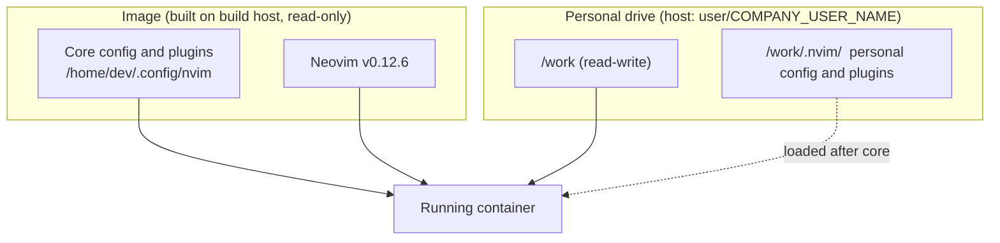
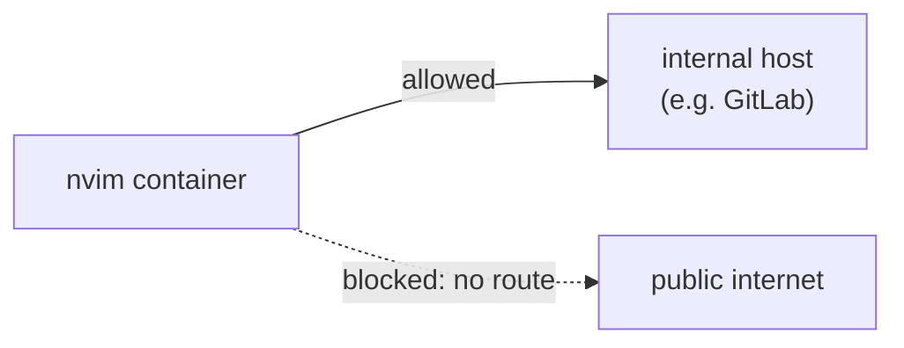
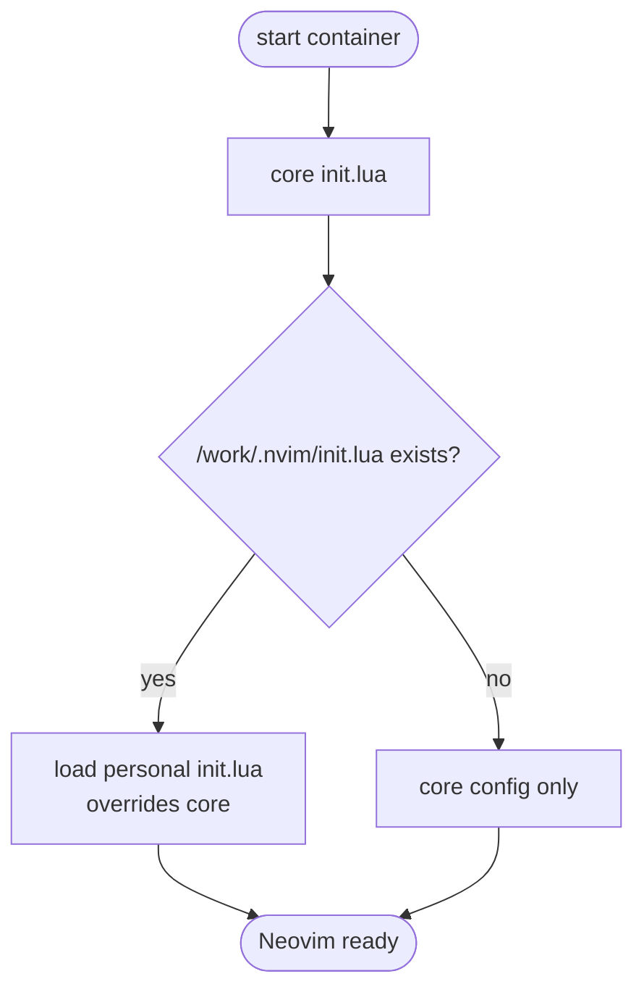
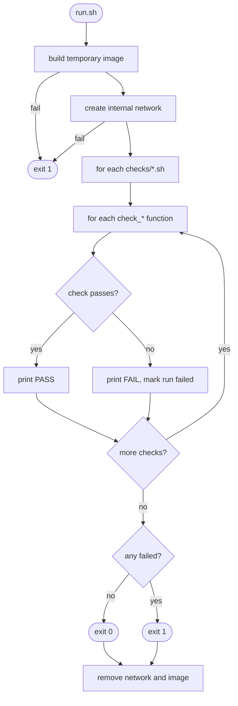

# How it works

A short guide to the design and the test harness, with pseudocode and flow diagrams.
Source of truth for requirements: spec #2 and its child tickets.

## Layers

The container is built from three layers. Each one is mounted or baked in separately.



## Network

The container runs on an internal-only Docker network. Internal hosts are reachable, the internet is not.



## Start-up

```text
function start_container(user):
    drive  = "user/" + env.COMPANY_USER_NAME
    run nvim with:
        network  = nvim-internal            # internal-only, no default route
        user     = host uid:gid             # so files on the drive are owned by the user
        mount    = drive -> /work           # the only writable location
    nvim loads:
        1. core init.lua                    # baked into the image
        2. /work/.nvim/init.lua if present  # personal overrides, loaded last
```



## Test harness

`tests/run.sh` builds a temporary image, runs each check against it, then removes everything it made.

```text
function run(checks_dir = tests/checks, context = "."):
    TEST_IMAGE = "nvim-container:test-" + pid
    NETWORK    = "nvim-container-test-" + pid
    on exit:
        remove NETWORK and TEST_IMAGE
    build TEST_IMAGE from context          # fail the run if the build fails
    create NETWORK with --internal         # fail the run if it cannot be created
    failed = false
    for each file in checks_dir/*.sh:
        source file
        for each function named check_*:
            if function succeeds:
                print PASS: name
            else:
                print FAIL: name           # to stderr
                failed = true
            unset function
    exit non-zero if failed
```



## Checks

Each check is a function named `check_*` in `tests/checks/`. It returns 0 for pass and non-zero for fail. Checks test behaviour from outside the container.

| File | Check | Behaviour |
| --- | --- | --- |
| `startup.sh` | `check_nvim_starts_on_internal_network` | Neovim starts and reports v0.12.6 |
| `plugins.sh` | `check_no_vendored_plugins` | no plugin folder exists yet (changes in ticket #4) |
| `mounts.sh` | `check_work_is_writable` | the container user can write to `/work` |
| `network.sh` | `check_internet_is_unreachable` | a public IP cannot be reached |

```text
function check_internet_is_unreachable():
    result = run container on NETWORK:
        bash: connect to 1.1.1.1:443 with a 5 second timeout
    if result succeeded:
        print "container reached the internet"
        return failure
    return success
```

## Harness tests

`tests/run_test.sh` tests the harness itself with fixture images and fixture checks, so the harness is driven by tests too.

```text
function test(name, fixture checks, expectation):
    dir = write fixture checks
    output, status = run tests/run.sh with NVIM_TEST_CHECKS_DIR = dir
    assert expectation(output, status)

tests:
    passing check   -> exit 0, "PASS: check_..." printed
    failing check   -> exit non-zero, "FAIL: check_..." printed
    check runs      -> NETWORK is an internal network
    check runs      -> TEST_IMAGE exists while checks run
    after the run   -> TEST_IMAGE and NETWORK are gone
```

## Status

| Ticket | Issue | State |
| --- | --- | --- |
| 01 minimal image | #3 | done, closed |
| 13 test harness | #17 | PR #20 |
| 12 internal reachability | #16 | not started |
| 02 vendored plugins | #4 | not started |
